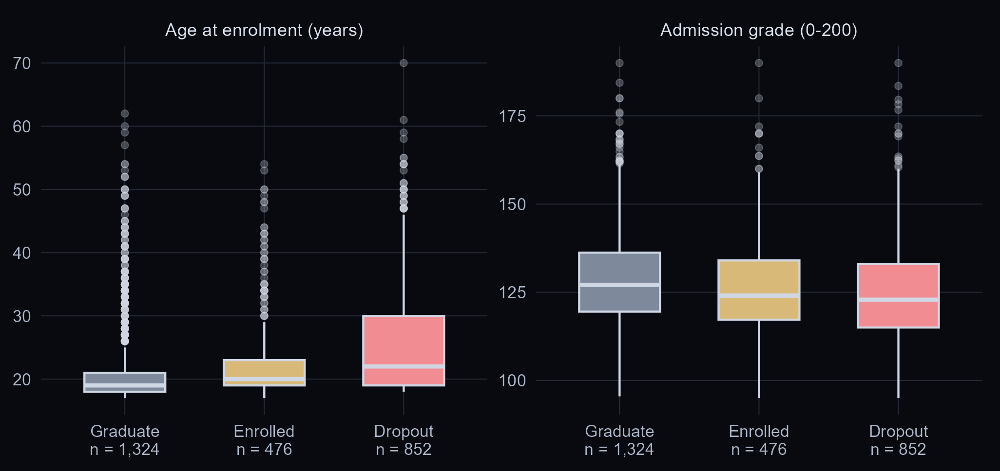
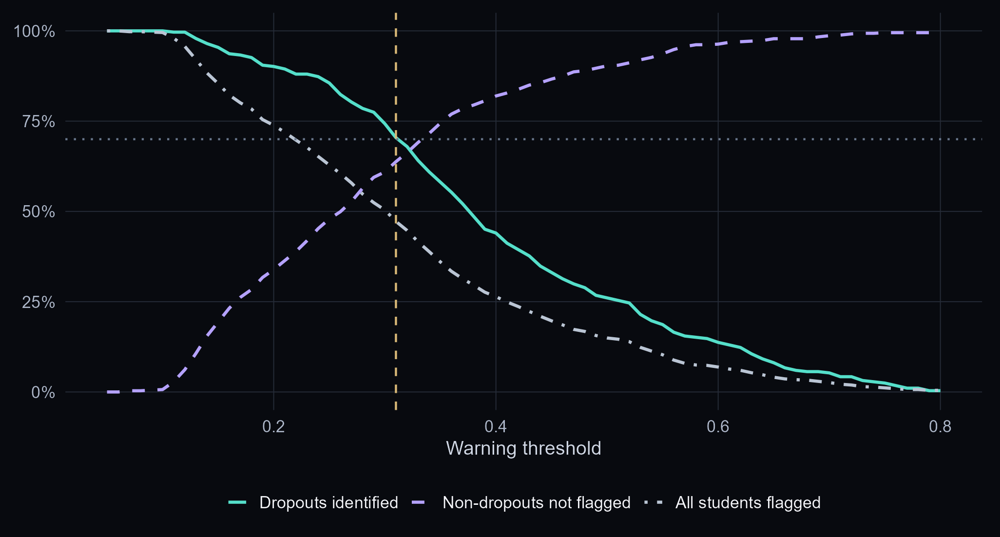
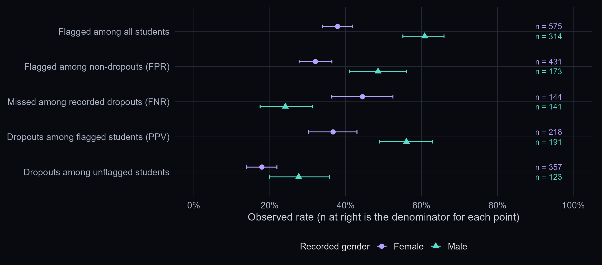

```{r setup, include=FALSE}
source("R/setup.R")
knitr::opts_chunk$set(echo = TRUE, message = FALSE, warning = FALSE)
r <- load_results()
knitr::read_chunk("R/analysis.R")
source("R/refresh_figures.R")
refresh_presentation_figures(r)
```

## Research question and endpoint

Can information available at enrolment identify students later recorded as Dropout at the source's normal course endpoint? Who is more likely to be missed by the same warning rule?

We retain Graduate and Enrolled as no recorded Dropout at that endpoint. Enrolled does not mean graduated. The source's definition also includes changing course or institution; the outcome is not a direct measure of leaving higher education or needing support. A separate Dropout-versus-Graduate sensitivity check changes the analysis population explicitly.

This notebook brings together the saved analysis and working decisions. The complete statistical implementation is in [R/analysis.R](R/analysis.R), the pre-specified design is in [docs/analysis-plan.md](docs/analysis-plan.md), and the source audit is in [docs/source-notes.md](docs/source-notes.md). It is not a record of check-in meetings or a completed final report.

The code below comes directly from the named sections of [R/analysis.R](R/analysis.R). The displayed blocks follow the execution order. The tables and figures use results produced by the same script.

| Stage | File and output |
| --- | --- |
| Read data | data/data.csv provides original rows and outcome labels. |
| Compute | R/analysis.R produces splits, scores, error counts and bootstrap intervals in results/. |
| Load and plot | R/setup.R refreshes missing or stale outputs. R/refresh_figures.R draws the charts from those results. |
| Present and check | This notebook, the slides and the notes use the shared outputs. verify_project.R recomputes key quantities from raw rows and saved scores. |

## Data inspection

```{r data-check}
students <- read.csv("data/data.csv", sep = ";", check.names = FALSE,
                     fileEncoding = "UTF-8-BOM")
names(students) <- trimws(names(students))
data.frame(records = nrow(students), variables = ncol(students),
           explicit_missing_cells = sum(is.na(students)),
           duplicated_rows = sum(duplicated(students)))
knitr::kable(as.data.frame(table(students$Target)),
             col.names = c("Recorded outcome", "Records"))
```

The dataset is UCI 697 from one Portuguese institution. Its coded categories need interpretation: course and recorded gender are not numerical distances. The timing and unknown-code audit is saved in `results/variable-timing-audit.csv` and `results/coded-unknown-audit.csv`. Blank-cell checks alone do not establish data quality.

The script preserves the three labels, creates the binary outcome and records a profile identifier. If full rows repeat, their profiles stay in the same partition. Codes that the dictionary calls unknown or blank can exist even when a CSV cell is populated. They are counted by field and excluded from the primary fit.

```{r show-data-preparation, ref.label="data-preparation", eval=FALSE}
```

```{r codes}
knitr::kable(read.csv("results/coded-unknown-audit.csv"))
```

## Entry inputs and exploratory figures

We use enrolment age, admission grade and course as a factor. Later-semester results are unavailable at the intended prediction time. Financial variables with unclear recording time are excluded conservatively. Recorded gender is reserved for the main audit, with a separate gender-inclusive comparison model.

The exploratory figures use training records. We show group sizes and overlapping distributions rather than treating a group pattern as an individual outcome.

```{r entry-figure, echo=FALSE, out.width="95%"}

```

## Fit, validate, then test

The fixed seed is 20261105. Training fits the model, validation chooses the threshold, and test records evaluate the frozen rule. Identical full-record profiles stay together within a partition. The validation objective of at least 70% sensitivity is an illustrative project choice, not university policy. We do not select a threshold on the test results.

The split is stratified by the original outcome and recorded gender. Each partition has a different role.

```{r show-data-split, ref.label="data-split", eval=FALSE}
```

```{r partition-counts}
splits <- read.csv("results/split-counts.csv")
knitr::kable(splits)
```

Course is an unordered factor. The fitted model is additive on the log-odds scale. Holding course and admission grade fixed, the age coefficient gives the log-odds change for ten years. Exponentiating it gives the odds multiplier. A change in probability depends on the starting probability. For admission10 the unit is ten admission-grade points out of 200, with age and course held fixed. Course 171 (Animation and Multimedia Design) is the reference, so each other course coefficient compares the two courses at the same age and grade. These are conditional associations.

```{r show-model-fit, ref.label="model-fit", eval=FALSE}
```

```{r odds-ratios}
coefficients <- read.csv("results/primary-coefficients.csv")
slopes <- subset(coefficients, term %in% c("age10", "admission10"))
slopes$odds_multiplier <- exp(slopes$coefficient)
knitr::kable(slopes, digits = 3, col.names = c("Predictor", "Log-odds coefficient", "Odds multiplier"))
```

The following functions count predicted/recorded pairs and divide by the applicable population. A zero denominator yields NA. From the validation cutoffs meeting 70% sensitivity, we pick the one with the highest specificity and use the higher cutoff for ties. Seventy per cent is an illustrative goal chosen for this project.

```{r show-metric-functions, ref.label="metric-functions", eval=FALSE}
```

```{r show-threshold-selection, ref.label="threshold-selection", eval=FALSE}
```

```{r threshold-figure, echo=FALSE, out.width="95%"}

```

## Follow-up: what course adds

The main model was already fixed when we did this comparison. Following *Cross Validation* (pp. 29–33 and 38–40), we used the same five folds for both logistic models within the original training partition. Each round fits on four folds and predicts the fifth. AUC measures ranking and Brier score measures squared probability error.

```{r training-course-cross-validation}
source("R/training-course-cv.R")
course_cv <- training_course_cv()
knitr::kable(course_cv$folds, digits = 3)
knitr::kable(course_cv$average, digits = 3)
```

Every fold used both models on the same held-out training records. This comparison does not select a new cutoff or involve the original validation or test records.

## Test performance and error costs

Accuracy, sensitivity and precision have different denominators. The always-no-warning baseline illustrates why accuracy alone is insufficient for this question. Lowering the threshold can identify more recorded dropouts while also creating more false warnings.

The historical test partition evaluates the frozen rule. Its results have already been seen. Any change prompted by them would need separate validation. The baseline issues no warnings, so its precision is undefined.

```{r show-test-scoring, ref.label="test-scoring", eval=FALSE}
```

```{r test-results}
knitr::kable(read.csv("results/test-metrics.csv"), digits = 3)
knitr::kable(read.csv("results/test-metric-intervals.csv"), digits = 3)
```

## Group error patterns and fairness criteria

We compare warning rates for Independence, both false-positive and false-negative rates for Separation, and outcomes within both warned and unwarned groups for binary Sufficiency. We report denominators and uncertainty. Rate differences do not by themselves establish discrimination; a non-significant difference would not prove equality.

The audit takes recorded Dropout as positive and applies the same threshold to both recorded-gender groups. Every statistic uses its own denominator.

| Criterion | Denominator | Statistic |
| --- | --- | --- |
| Independence | Everyone in a recorded group | Warnings / group size |
| Separation | Recorded dropouts | Misses / recorded dropouts (FNR) |
| Separation | Records with no recorded dropout | False warnings / those records (FPR) |
| Sufficiency | Warned records | Recorded dropouts / warnings (PPV) |
| Sufficiency | Unwarned records | Recorded dropouts / unwarned records |
| Probability calibration | Records in the same score band and group | Observed dropout proportion compared with mean predicted probability |

The tables contain group sizes and all four counts. TP + FN gives the recorded dropout count in each group. Use the gap interval for a direct group comparison.

```{r show-group-audit, ref.label="group-audit", eval=FALSE}
```

```{r fairness-results}
knitr::kable(read.csv("results/fairness-group-metrics.csv"), digits = 3)
knitr::kable(read.csv("results/fairness-gaps.csv"), digits = 3)
```

```{r fairness-figure, echo=FALSE, out.width="95%"}

```

For each of 5,000 replicates, we resample scored test rows with replacement within each recorded-gender group and retain each row's original flag and outcome. Recalculating the group rates and subtracting paired estimates produces a distribution for each gap. The 2.5th and 97.5th percentiles form pointwise 95% intervals conditional on this fitted model and cutoff. They leave out refitting, cohort effects and transport to another institution.

```{r show-bootstrap, ref.label="bootstrap", eval=FALSE}
```

## Exploratory comparison by Displaced status

Using the original held-out predictions, we compared warning errors at 0.31 and 0.50 by the recorded Displaced field. Code 1 identifies students marked as having left home to study and code 0 identifies the remaining students. The exact recording criteria are undocumented in the public data dictionary. This comparison does not refit the model or select a new threshold.

```{r displaced-audit}
source("R/displaced-audit.R", encoding = "UTF-8")
d <- displaced_audit()
knitr::kable(data.frame(
  Threshold = sprintf("%.2f", d$threshold),
  Displaced = d$group,
  `Missed dropout` = sprintf("%d/%d (%s)", d$missed, d$dropouts, pct(d$fnr)),
  `False warning` = sprintf("%d/%d (%s)", d$false_warnings, d$no_dropout, pct(d$fpr)),
  check.names = FALSE
))
```

The higher threshold increased missed dropouts and reduced false warnings in both groups. The missed-dropout rate gap widened from 15.7 to 21.1 percentage points in this grouping. The original gender comparison showed a narrower gap at the higher threshold.


## Checks, limitations and reproducibility

AUC measures score ranking with half credit for ties. Brier score measures squared probability error. Calibration compares predicted and observed probabilities. Ordinary or adjusted OLS R-squared and OLS residual normality belong to a different model. A historical split from one institution gives no direct evidence about performance on later cohorts or about what happens after offering support.

The separate sensitivity checks address including gender and restricting the endpoint comparison. They do not retrospectively redefine the primary question or establish a new validated model.

```{r sensitivity-checks}
knitr::kable(read.csv("results/fairness-gender-inclusive.csv"), digits = 3)
knitr::kable(read.csv("results/enrolled-definition-sensitivity.csv"), digits = 3)
```

To recompute the statistical analysis explicitly, run the following from the project directory. It is shown without execution here so reading or knitting this notebook does not silently replace frozen results.

```{r recompute, eval=FALSE}
source("R/analysis.R")
source("verify_project.R")
source("render_project.R")
```

The independent verification script checks raw-row identities, partition separation, validation-only threshold selection, saved predictions, metric denominators and all three group criteria. See `results/verification.txt`. The model identifies predictive patterns in historical administrative records; it has not been shown to reduce dropout or to support operational decisions safely.

Our learning and assistance are described in [docs/learning-process.md](docs/learning-process.md). At the initial analysis stage, the group used ChatGPT explanations and documentation for unfamiliar methods and reported rewriting and running the main analysis. The later course review links logistic regression, ROC, AUC and cutoff trade-offs to the supplied lessons. See the learning notes for the project’s assistance record.
