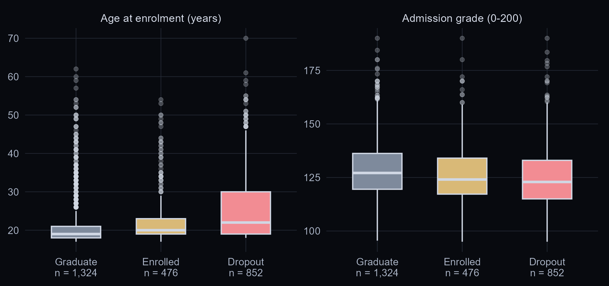
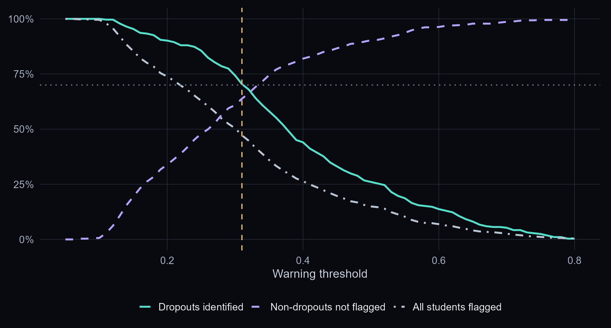
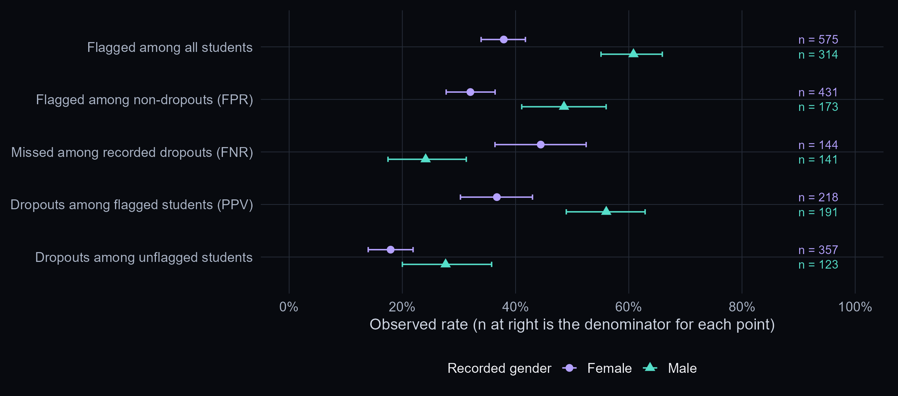

```{r setup, include=FALSE}
source("R/setup.R")
knitr::opts_chunk$set(echo = TRUE, message = FALSE, warning = FALSE)
r <- load_results()
```

## Research question and endpoint

Can information available at enrolment identify students later recorded as Dropout at the source's normal course endpoint? Who is more likely to be missed by the same warning rule?

We retain Graduate and Enrolled as no recorded Dropout at that endpoint. Enrolled does not mean graduated. The source's definition also includes changing course or institution; the outcome is not a direct measure of leaving higher education or needing support. A separate Dropout-versus-Graduate sensitivity check changes the analysis population explicitly.

This notebook brings together the saved analysis and working decisions. The complete statistical implementation is in [R/analysis.R](R/analysis.R), the pre-specified design is in [docs/analysis-plan.md](docs/analysis-plan.md), and the source audit is in [docs/source-notes.md](docs/source-notes.md). It is not a record of check-in meetings or a completed final report.

## Data inspection

```{r data-check}
students <- read.csv("data/data.csv", sep = ";", check.names = FALSE,
                     fileEncoding = "UTF-8-BOM")
names(students) <- trimws(names(students))
data.frame(records = nrow(students), variables = ncol(students),
           explicit_missing_cells = sum(is.na(students)),
           duplicated_rows = sum(duplicated(students)))
knitr::kable(as.data.frame(table(students$Target)),
             col.names = c("Recorded outcome", "Records"))
```

The dataset is UCI 697 from one Portuguese institution. Its coded categories need interpretation: course and recorded gender are not numerical distances. The timing and unknown-code audit is saved in `results/variable-timing-audit.csv` and `results/coded-unknown-audit.csv`. Blank-cell checks alone do not establish data quality.

## Entry inputs and exploratory figures

We use enrolment age, admission grade and course as a factor. Later-semester results are unavailable at the intended prediction time. Financial variables with unclear recording time are excluded conservatively. Recorded gender is reserved for the main audit, with a separate gender-inclusive comparison model.

The exploratory figures use training records. We show group sizes and overlapping distributions rather than treating a group pattern as an individual outcome.

```{r entry-figure, echo=FALSE, out.width="95%"}

```

## Fit, validate, then test

The fixed seed is 20261105. Training fits the model, validation chooses the threshold, and test records evaluate the frozen rule. Identical full-record profiles stay together within a partition. The validation objective of at least 70% sensitivity is an illustrative project choice, not university policy. We do not select a threshold on the test results.

```{r partition-counts}
splits <- read.csv("results/split-counts.csv")
knitr::kable(splits)
```

```{r threshold-figure, echo=FALSE, out.width="95%"}

```

## Test performance and error costs

Accuracy, sensitivity and precision have different denominators. The always-no-warning baseline illustrates why accuracy alone is insufficient for this question. Lowering the threshold can identify more recorded dropouts while also creating more false warnings.

```{r test-results}
knitr::kable(read.csv("results/test-metrics.csv"), digits = 3)
knitr::kable(read.csv("results/test-metric-intervals.csv"), digits = 3)
```

## Group error patterns and fairness criteria

We compare warning rates for Independence, both false-positive and false-negative rates for Separation, and outcomes within both warned and unwarned groups for binary Sufficiency. We report denominators and uncertainty. Rate differences do not by themselves establish discrimination; a non-significant difference would not prove equality.

```{r fairness-results}
knitr::kable(read.csv("results/fairness-group-metrics.csv"), digits = 3)
knitr::kable(read.csv("results/fairness-gaps.csv"), digits = 3)
```

```{r fairness-figure, echo=FALSE, out.width="95%"}

```

The bootstrap fixes the fitted model and selected threshold while resampling test records within recorded-gender groups. It does not include refitting, clustering by cohort, transport to another institution, or the effect of acting on a warning.

## Exploratory comparison by Displaced status

Using the original held-out predictions, we compared warning errors at 0.31 and 0.50 by the recorded Displaced field. Code 1 identifies students marked as having left home to study and code 0 identifies the remaining students. The exact recording criteria are undocumented in the public data dictionary. This comparison does not refit the model or select a new threshold.

```{r displaced-audit}
source("R/displaced-audit.R", encoding = "UTF-8")
d <- displaced_audit()
knitr::kable(data.frame(
  Threshold = sprintf("%.2f", d$threshold),
  Displaced = d$group,
  `Missed dropout` = sprintf("%d/%d (%s)", d$missed, d$dropouts, pct(d$fnr)),
  `False warning` = sprintf("%d/%d (%s)", d$false_warnings, d$no_dropout, pct(d$fpr)),
  check.names = FALSE
))
```

The higher threshold increased missed dropouts and reduced false warnings in both groups. The missed-dropout rate gap widened from 15.7 to 21.1 percentage points in this grouping. The original gender comparison showed a narrower gap at the higher threshold.

## Checks, limitations and reproducibility

The separate sensitivity checks address including gender and restricting the endpoint comparison. They do not retrospectively redefine the primary question or establish a new validated model.

```{r sensitivity-checks}
knitr::kable(read.csv("results/fairness-gender-inclusive.csv"), digits = 3)
knitr::kable(read.csv("results/enrolled-definition-sensitivity.csv"), digits = 3)
```

To recompute the statistical analysis explicitly, run the following from the project directory. It is shown without execution here so reading or knitting this notebook does not silently replace frozen results.

```{r recompute, eval=FALSE}
source("R/analysis.R")
source("verify_project.R")
source("render_project.R")
```

The independent verification script checks raw-row identities, partition separation, validation-only threshold selection, saved predictions, metric denominators and all three group criteria. See `results/verification.txt`. The model identifies predictive patterns in historical administrative records; it has not been shown to reduce dropout or to support operational decisions safely.

Our learning and assistance are described in [docs/learning-process.md](docs/learning-process.md). Unfamiliar modelling and evaluation methods were learned using AI explanations and documentation, then reimplemented and checked. The existing disclosure of assistance with initial drafts, source checks and presentation design is retained.
