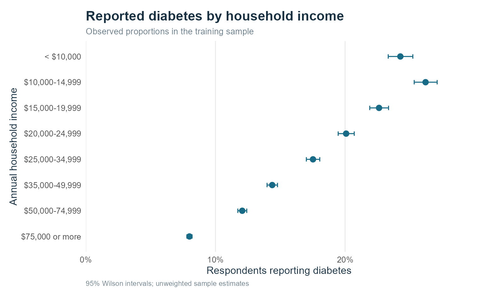
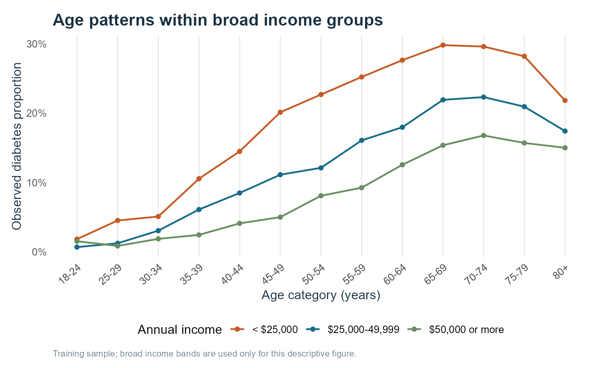
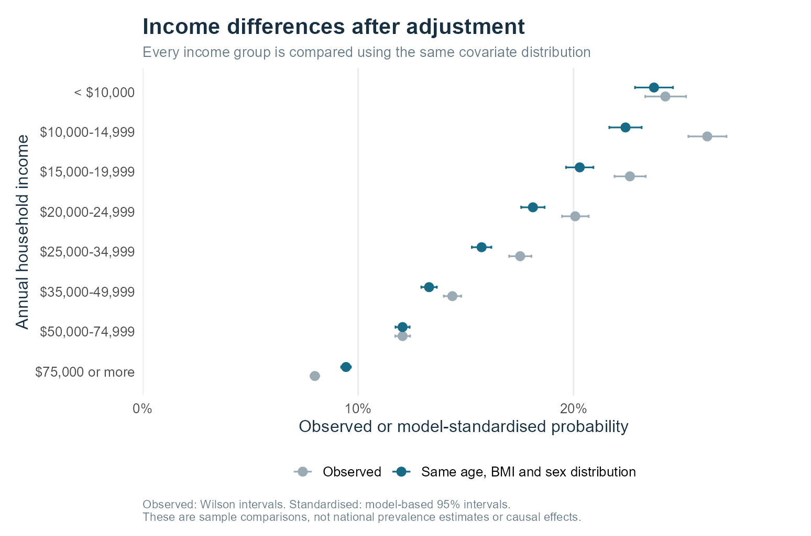
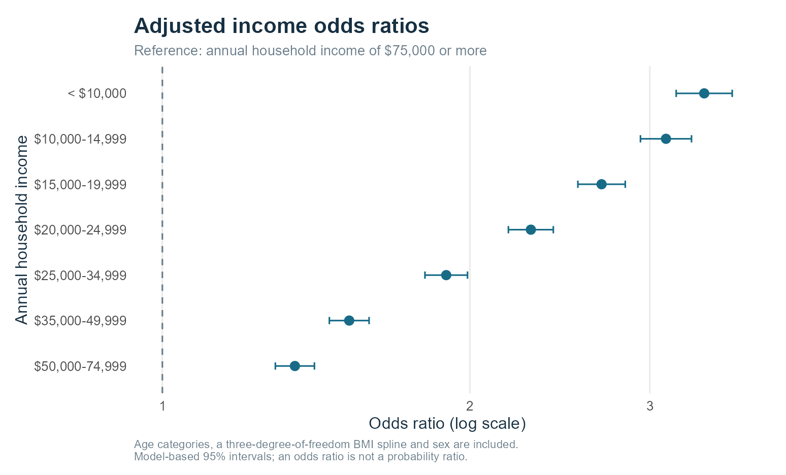
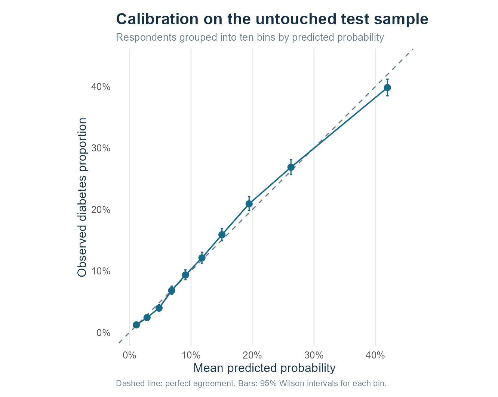
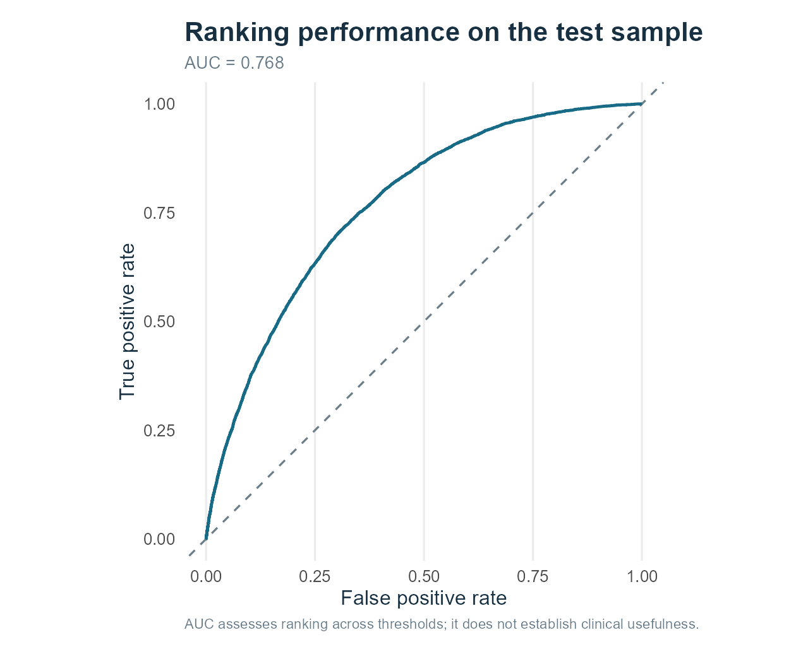
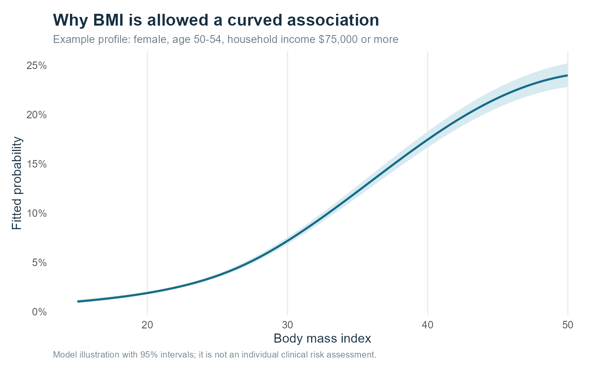

```{r setup, include=FALSE}
source("R/setup.R")
knitr::opts_chunk$set(message=FALSE, warning=FALSE, fig.align="center", out.width="100%")
r <- load_results()
```

## Question and analysis scope

Does reported diabetes differ by household income after accounting for age, BMI and sex? The primary question concerns adjusted associations in a selected sample. Prediction is a secondary model check.

The full analysis is in `R/analysis.R`. Rendering a final document checks the code and data fingerprints and regenerates stale results. `render_project.R` runs the analysis afresh before rendering all deliverables.

No result relies on downloading a dataset, calling an AI model or executing somebody else's notebook at render time.

## Provenance and outcome audit

- UCI file: `data/uci_cdc_diabetes_891.csv`.
- Linked original: `data/diabetes_012_health_indicators_BRFSS2015.csv`.
- Source metadata and direct row-matching audit are stored in `data/`.
- Retrieved: 24 October 2026. Original study year: 2015, established from the original publisher's files and description.
- Source links: [UCI](https://archive.ics.uci.edu/dataset/891/cdc+diabetes+health+indicators), [original publisher](https://www.kaggle.com/datasets/alexteboul/diabetes-health-indicators-dataset), [CDC documentation](https://www.cdc.gov/brfss/annual_data/annual_2015.html).

The UCI page and the original dataset description both state that binary positives include prediabetes. Direct file comparison contradicts that wording. The original three-category file resolves the interpretation: all original class 2 records are binary positives; original class 1 is included in binary zero. All 21 feature columns match, in the same row order.

```{r label-audit}
knitr::kable(r$label_audit)
```

This project uses the original class 2 definition of reported diabetes. The comparison category includes no reported diabetes, diabetes reported only during pregnancy, and prediabetes. It is not labelled "healthy". The extract cannot distinguish diabetes type 1 from type 2.

```{r audit-summary}
knitr::kable(data.frame(
  Check=c("Rows", "Indicators", "Diabetes", "Prediabetes in the comparison class",
          "Repeated response profiles retained", "BMI above 60 retained initially"),
  Value=c(r$audit$n,r$audit$n_features,r$audit$n_positive,r$audit$n_prediabetes,
          r$audit$duplicated_response_profiles,r$audit$bmi_over_60)))
```

There are no NA values in the supplied CSV. That says nothing about excluded or nonresponding people in the original survey. Repeated profiles are kept because the ID is only a row identifier and identical survey answers need not be duplicate people.

## Selected variables

```{r dictionary}
dictionary <- data.frame(
  Variable=c("Diabetes_binary","Income","Age","BMI","Sex","ID"),
  Treatment=c("Binary outcome","Unordered factor; 8 bands","Factor; 13 categories",
              "Numeric; natural cubic spline with df = 3","Binary recorded category",
              "Excluded from models"),
  Interpretation=c("Positive matches original Diabetes_012 = 2",
                   "Annual household income; reference = $75,000 or more",
                   "1 is age 18-24, not age one",
                   "Do not assume a constant linear change in log-odds",
                   "0 female, 1 male in the supplied coding",
                   "An arbitrary row identifier, not a clinical attribute"))
knitr::kable(dictionary)
```

```{r income-dictionary}
knitr::kable(data.frame(Code=1:8, AnnualHouseholdIncome=income_labels))
```

```{r age-dictionary}
knitr::kable(data.frame(Code=1:13, AgeInYears=age_labels))
```

The official codebook is linked in the report. Income is not per-person disposable income. No survey weight, stratum, primary sampling unit, ethnicity or state variable is present in this extract.

## Split and prespecified models

The seed is 20261024. The split is stratified by binary outcome and performed before exploratory plots. The training and test ID sets are disjoint.

```{r split-summary}
knitr::kable(data.frame(
  Split=c("Training", "Test"),
  N=c(r$train_n,r$test_n),
  Diabetes=c(r$train_cases,r$test_cases),
  Fraction=c(r$train_cases/r$train_n,r$test_cases/r$test_n)))
```

Three fixed prediction comparisons were specified: the training proportion as a constant baseline; age, BMI and sex; then age, BMI, sex and income. No threshold was tuned on the test set. A threshold of 0.5 is shown to illustrate the danger of accuracy alone.

```{r model-example, eval=FALSE}
adjusted <- glm(
  Diabetes ~ Income + Age + splines::ns(BMI, df = 3) + Sex,
  family = binomial(),
  data = train
)
```

The income coefficients compare each category with $75,000 or more. The model has `r r$model_rank` independent coefficient columns and converged without missing coefficients.

## Exploratory results

```{r income-summary}
tab <- r$raw_income[,c("IncomeLabel","N","Cases","Rate","MeanBMI","Age60plus")]
tab$Rate <- pct(tab$Rate)
tab$MeanBMI <- num(tab$MeanBMI,1)
tab$Age60plus <- pct(tab$Age60plus)
knitr::kable(tab)
```

```{r raw-income-plot, echo=FALSE}

```

The second-lowest income band has the highest raw proportion. The income gradient is not strictly monotonic before adjustment.

```{r age-plot, echo=FALSE}

```

The age plot uses three broader income bands only to keep the descriptive figure readable. The main models retain all eight original bands. No interaction is fitted in the primary model; that simplification is stated as a limitation.

## Adjusted comparisons

```{r adjusted-odds}
tab <- r$odds_ratios
tab$Income <- income_labels[tab$IncomeCode]
knitr::kable(tab[,c("Income","OR_crude","OR_adjusted","lower_adjusted","upper_adjusted")],digits=3)
```

```{r adjusted-plot, echo=FALSE}

```

Standardisation averages predictions across the empirical joint distribution of age, BMI and sex in the training sample. For efficiency, repeated covariate combinations are aggregated with their exact frequencies. This produces the same mean as predicting every respondent separately.

For uncertainty, the derivative of a mean fitted probability is the weighted mean of p(1-p) multiplied by each design-matrix column. Its covariance is computed using the model coefficient covariance. The difference between two standardised means uses the difference between their gradient vectors, including their shared coefficient uncertainty. Reference-distribution uncertainty and the original complex survey design are not included.

```{r probability-table}
knitr::kable(r$standardised[,c("IncomeLabel","Estimate","lower","upper")],digits=4)
```

```{r odds-plot, echo=FALSE}

```

## Model evaluation

```{r full-test-metrics}
knitr::kable(r$metrics,digits=4)
```

For a constant probability below 0.5, every predicted class is negative: specificity is one and sensitivity is zero. That baseline still has about 86% accuracy. AUC uses average ranks for tied probabilities. Brier score is mean squared probability error; log loss penalises confidently wrong probabilities.

```{r calibration, echo=FALSE}

```

Calibration intercept: `r num(r$calibration_intercept,3)`. Calibration slope: `r num(r$calibration_slope,3)`. Their ideal values are zero and one. The ten-bin plot summarises calibration; agreement within bins does not demonstrate calibration within every income or age group.

```{r roc, echo=FALSE}

```

ROC thresholds group equal predictions together. AUC evaluates ranking, not future disease incidence. This is an internal holdout from one cleaned survey extract, not external validation.

## Sensitivity analyses

```{r sensitivities}
knitr::kable(r$sensitivity,digits=3)
```

The alternate models use the same original training allocation. Prediabetes exclusion removes only original class 1. The high-BMI sensitivity excludes BMI above 60 rather than silently altering values. These choices leave the original data unchanged.

```{r bmi-shape, echo=FALSE}

```

The curved BMI plot is for one example profile only. It is not a risk calculator. The model contains no income-by-age or income-by-BMI interactions; a future study should investigate overlap and whether this assumption is adequate.

## Reproducibility and remaining human tasks

The pipeline exports numerical tables, test predictions, figures, metadata and session information. The report and slides read the same results object. Re-running the analysis with the recorded seed regenerates those results. `verify_project.R` checks data labels, the split, the baseline, probability ranges and consistency between reported metrics and saved predictions.

Tutor feedback, live presentation practice, acceptance of repository invitations and individual peer evaluations are human tasks. No tutor feedback or individual contribution history is fabricated here.

## GenAI acknowledgement

ChatGPT assisted with planning and produced initial code and written drafts. The scripts were executed in R and their numerical outputs were checked. External example notebooks were not copied or executed as the analysis pipeline.
