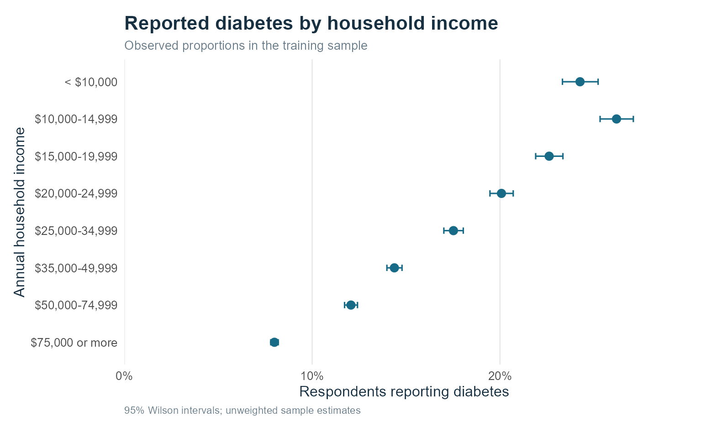
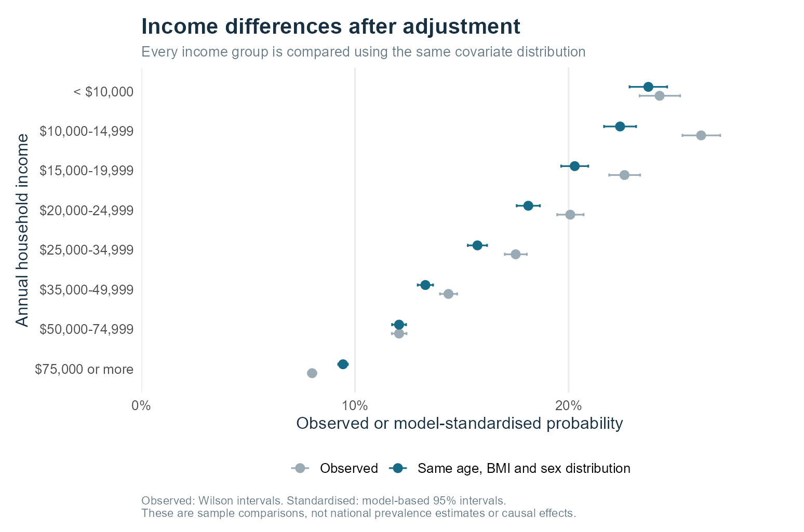
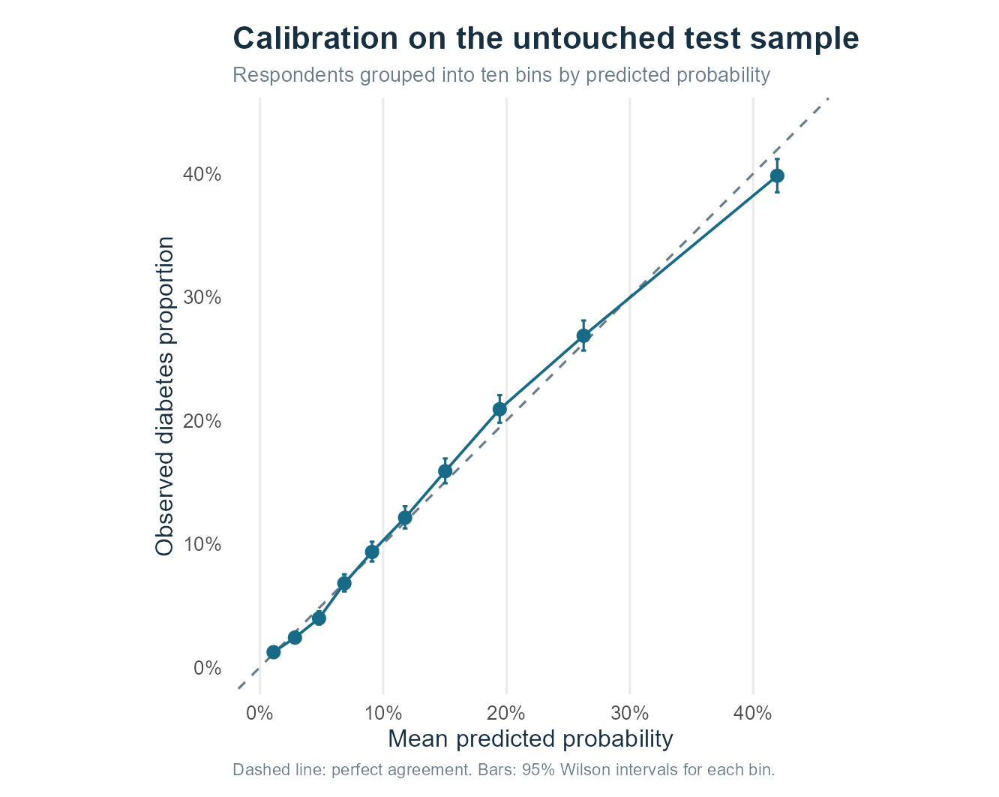

```{r setup, include=FALSE}
source("R/setup.R")
knitr::opts_chunk$set(echo=FALSE, message=FALSE, warning=FALSE,
                      fig.align="center", out.width="100%")
r <- load_results()
low <- r$raw_income[r$raw_income$IncomeCode == 1, ]
high <- r$raw_income[r$raw_income$IncomeCode == 8, ]
lo_adj <- r$standardised[r$standardised$IncomeCode == 1, ]
hi_adj <- r$standardised[r$standardised$IncomeCode == 8, ]
```

## Research question

**Does reported diabetes differ across household income groups after accounting for age and body mass index (BMI)?**

Income differences in health deserve attention because a single overall percentage can hide groups with quite different experiences. However, comparing income groups directly may also compare different age distributions and body sizes. We examine whether the income pattern remains when these measured differences are taken into account. Sex is included as an additional adjustment variable.

The aim is to describe a health inequality within this dataset, rather than produce a clinical diagnostic tool. A secondary question is whether adding income improves predictions beyond age, BMI and sex. This separates an association that helps describe groups from a model that can reliably classify individuals. The analysis uses R throughout; the code, data audit and additional figures are available in the [project repository](https://github.com/Tigershengsheng/ids-project/tree/cdc-diabetes-final).

## Data and preparation

The data are a cleaned extract of the CDC's 2015 Behavioral Risk Factor Surveillance System (BRFSS), a telephone survey of adults, obtained through the UCI repository on 24 October 2026. The extract contains `r num(r$audit$n)` respondents and `r r$audit$n_features` indicators. It is a selected subset of the original survey, not a fresh representative sample of the United States. The extract omits survey weights, strata and sampling clusters. All estimates here therefore describe the analysed sample.

We checked the outcome against the original three-category file linked by UCI. Although the website describes the positive class as including prediabetes, every positive record matched the original diabetes category. The `r num(r$audit$n_prediabetes)` prediabetes records were actually coded zero. We define the outcome as **reported diabetes**; the comparison group includes prediabetes and diabetes reported only during pregnancy. We examine prediabetes inclusion in a sensitivity analysis. The two files' 21 predictor columns matched row for row.

Annual household income has eight bands, from below $10,000 to $75,000 or more. Age has 13 categories, from 18-24 to 80 or older; its codes are not ages in years. We used the CDC codebook to interpret these variables. BMI is numeric, while sex is a recorded binary category. None of the supplied columns contained missing values, but prior removal of incomplete responses can still introduce selection bias.

We retained identical response profiles because matching answers do not establish that the same person was recorded twice. The arbitrary ID column was excluded from modelling. Unusually high BMI values were retained initially and investigated separately.

Overall, the diabetes category contained 35,346 respondents, or 13.9% of the extract. This percentage is useful for understanding the dataset's imbalance, but should not be quoted as the national diabetes prevalence.

## Methods

Before exploratory comparisons, we randomly allocated respondents to training and test sets, stratified by outcome, using seed 20261024. The split produced `r num(r$train_n)` training and `r num(r$test_n)` test records. Exploratory summaries and model estimation used training data; the test outcomes were reserved for evaluation.

We used the full extract rather than the separately supplied balanced file. Artificially equalising the number of positive and negative records would change the observed proportions and the interpretation of fitted probabilities. We addressed imbalance through evaluation against a constant baseline and reporting sensitivity alongside accuracy.

We first calculated diabetes proportions within each income band, with 95% Wilson intervals. Logistic regression was appropriate for the binary outcome and kept fitted probabilities between zero and one. Income and age were categorical, avoiding an assumption that their numerical codes represented equal changes. The highest income category was the reference.

The adjusted model included income, age, sex and a natural cubic spline for BMI with three degrees of freedom. This allowed a modestly curved BMI association without fitting a separate effect at every value. The model assumed additive effects on the log-odds scale, without interactions. We reported income odds ratios, explicitly distinguishing odds from probabilities.

To make adjustment easier to interpret, we also calculated model-standardised probabilities. We predicted each training respondent's outcome probability at every income band while retaining that respondent's age, BMI and sex, then averaged within each hypothetical band. Each comparison consequently used the same covariate distribution. These are descriptive model comparisons, not estimates of what changing someone's income would cause. Their 95% intervals used the delta method and fitted coefficient covariance, conditional on this reference distribution.

## Findings

### Observed income differences

The training sample showed substantial income differences. Reported diabetes was `r pct(low$Rate)` in the lowest income band and `r pct(high$Rate)` in the highest, a difference of `r pp(r$gap$raw)`. The pattern was not perfectly ordered: the $10,000-14,999 band had the highest observed proportion.

```{r observed-figure, fig.cap="Figure 1. Observed proportions and 95% Wilson intervals in the training sample."}

```

The groups also differed in their measured characteristics. For example, `r pct(low$Age60plus)` of the lowest income group were aged 60 or older, compared with `r pct(high$Age60plus)` of the highest. Mean BMI was `r num(low$MeanBMI,1)` and `r num(high$MeanBMI,1)` respectively. This supported making an adjusted comparison rather than interpreting the raw gap alone.

### Differences after adjustment

Using the same age, BMI and sex distribution, the estimated proportions were `r pct(lo_adj$Estimate)` for the lowest income band and `r pct(hi_adj$Estimate)` for the highest. The adjusted difference was `r pp(r$gap$adjusted)`, with a model-based 95% interval of `r num(100*r$gap$lower,1)` to `r num(100*r$gap$upper,1)` percentage points. Adjustment reduced the observed gap, but a substantial difference remained. The standardised probabilities decreased across successive income bands.

```{r adjusted-figure, fig.cap="Figure 2. Observed and model-standardised comparisons. Standardisation gives every income band the same age, BMI and sex distribution."}

```

The lowest versus highest income odds ratio was `r num(r$primary_or_low$OR,2)`, with a 95% interval of `r num(r$primary_or_low$lower,2)` to `r num(r$primary_or_low$upper,2)`. This does not mean that diabetes probability was `r num(r$primary_or_low$OR,2)` times higher. The probability comparison above gives a more direct account of the sample difference. Neither measure establishes that income itself caused the difference.

### Prediction and model checks

On the held-out test data, adding income increased AUC from `r num(r$metrics$AUC[2],3)` to `r num(r$metrics$AUC[3],3)` and reduced Brier score from `r num(r$metrics$Brier[2],4)` to `r num(r$metrics$Brier[3],4)`. AUC measures ranking across thresholds; lower Brier scores indicate smaller squared probability errors. Income added some predictive information, although the improvement was modest.

```{r metrics-table}
m <- r$metrics
tab <- data.frame(Model=m$Model, AUC=num(m$AUC,3),
                  Brier=num(m$Brier,4), Sensitivity=pct(m$Sensitivity))
names(tab)[4] <- "Sensitivity at 0.5"
knitr::kable(tab, caption="Table 1. Performance on the same untouched test sample.")
```

Accuracy alone was misleading. Predicting no diabetes for everyone already achieved `r pct(r$metrics$Accuracy[1])` accuracy. At a 0.5 threshold, the adjusted model achieved `r pct(r$metrics$Accuracy[3])` accuracy but identified only `r pct(r$metrics$Sensitivity[3])` of respondents reporting diabetes. It should not be presented as an effective screening rule.

Predicted and observed proportions were broadly aligned across ten probability groups. The calibration slope was `r num(r$calibration_slope,2)`, close to the ideal value of one. This supports reasonable aggregate probability calibration within the held-out sample, not accurate diagnosis or validation in another population.

```{r calibration-figure, out.width="78%", fig.cap="Figure 3. Test-sample calibration. The dashed line represents perfect agreement."}

```

### Sensitivity analyses

The lowest versus highest income odds ratio was `r num(r$sensitivity$OR[2],2)` with linear BMI, `r num(r$sensitivity$OR[3],2)` after excluding prediabetes, and `r num(r$sensitivity$OR[4],2)` after excluding BMI above 60, compared with `r num(r$sensitivity$OR[1],2)` originally. The direction and approximate size of the association remained similar. These checks address particular coding and modelling choices; they do not remove unmeasured confounding.

## Discussion and limitations

Income differences in reported diabetes were not explained completely by the age, BMI and sex terms used here. This makes socioeconomic differences a reasonable focus for further investigation and for discussions about accessible health education. The analysis cannot identify which intervention would reduce the gap or justify allocating services from these estimates alone.

The ethical interpretation matters too. An income association should not become a judgement about an individual's behaviour or a reason to restrict access to care. This dataset cannot separate personal choices from constraints such as working conditions or available support. The useful next step is to investigate those possible explanations with appropriate data and community input, rather than treat an income category as an explanation by itself.

Several limitations matter. The data are cross-sectional: diabetes may affect employment and income, so the direction of the relationship is uncertain. Reported diagnosis also depends on awareness and access to care; people with undiagnosed diabetes can appear in the comparison group. Household income is not adjusted for household size, and omitted factors include ethnicity and geography.

The model-based intervals assume independent records and an adequate model specification. Without the survey design variables, they are not design-correct BRFSS population intervals. Standardisation additionally compares covariate combinations that may be uncommon within some income bands. The absence of income interactions can hide differences across age or sex groups.

Finally, these are selected responses from 2015. They cannot establish current diabetes levels, represent UK families, or determine an individual's diagnosis. A useful extension would analyse the original survey with its weights and sampling design, examine covariate overlap and interactions, and validate the findings in newer data.

## Conclusion

In this sample, a sizeable income difference in reported diabetes remained after adjustment for age, BMI and sex. Income also modestly improved held-out predictions, but high accuracy concealed very low sensitivity at the usual 0.5 threshold. The findings support investigating socioeconomic differences while keeping group comparisons separate from causal claims and clinical decisions.

## References

- Centers for Disease Control and Prevention. *2015 BRFSS survey data and documentation*. [Source](https://www.cdc.gov/brfss/annual_data/annual_2015.html).
- Centers for Disease Control and Prevention. *2015 BRFSS codebook*, income, age and diabetes definitions. [Codebook](https://www.cdc.gov/brfss/annual_data/2015/pdf/codebook15_llcp.pdf).
- Centers for Disease Control and Prevention. *BRFSS frequently asked questions*, survey methods and weighting. [Methods](https://www.cdc.gov/brfss/about/brfss_faq.htm).
- Teboul, A. *Diabetes Health Indicators Dataset*, cleaned 2015 BRFSS files. Kaggle, CC0. [Original files](https://www.kaggle.com/datasets/alexteboul/diabetes-health-indicators-dataset).
- UCI Machine Learning Repository. *CDC Diabetes Health Indicators*. DOI: [10.24432/C53919](https://doi.org/10.24432/C53919). Retrieved 24 October 2026; label interpretation checked against the original files.

### GenAI acknowledgement

ChatGPT assisted with research planning and produced initial R code and drafts of the report and slides. The accompanying R scripts generated the reported results, which were checked against saved summaries and predictions.
